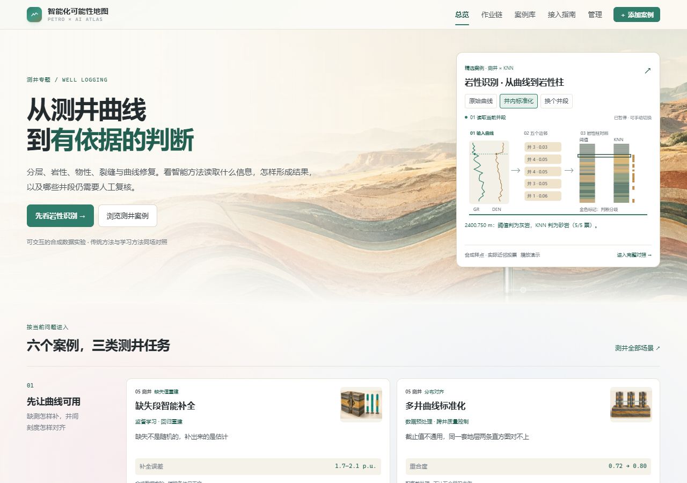
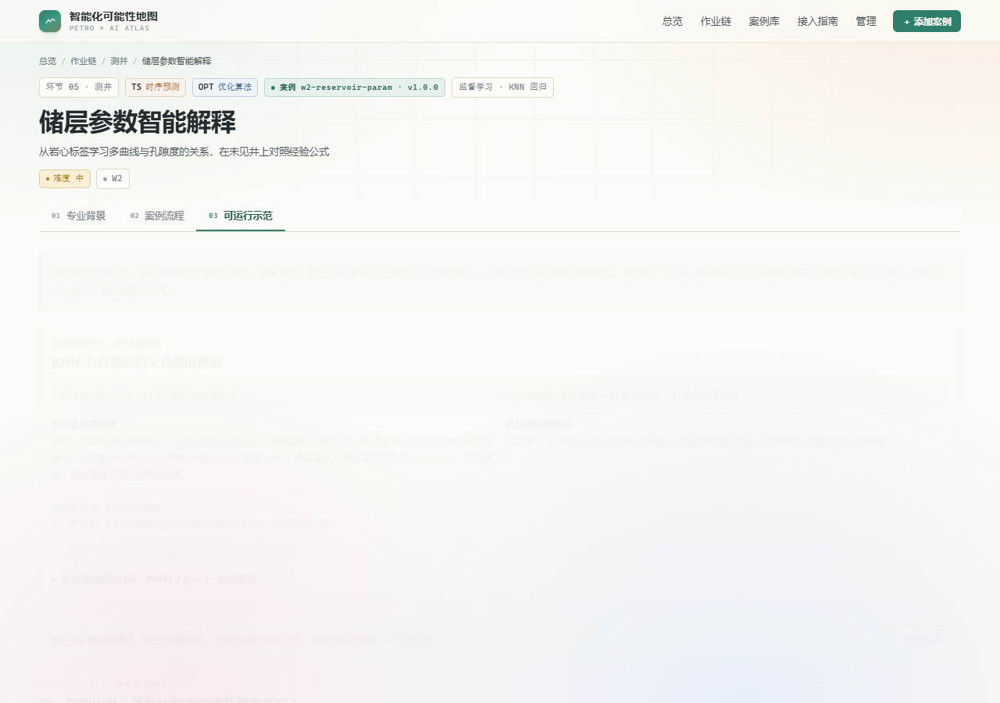
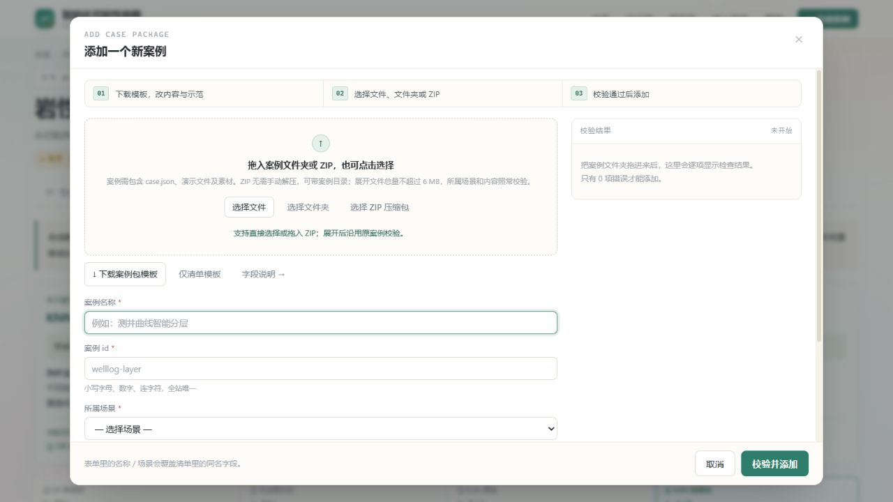

# 测井智能化案例工作台：项目提案与评审说明

版本：2026-11-03。本文描述已实现的前端原型，并提出后续改进方向，供课程评审或其他 AI 独立打分。

- 在线入口：[Petro × AI Atlas](https://boveyh.github.io/Intelligent-Map-for-Oil-Exploration-and-Development/)
- 源码仓库：[GitHub](https://github.com/boveyh/Intelligent-Map-for-Oil-Exploration-and-Development)
- 本地入口：用 HTTP 服务器打开仓库根目录 `index.html`；当前改版不支持 `file://` 双击路径。

## 1. 项目目标

本项目围绕测井中的具体判断，展示**智能方法如何加入一个石油作业场景，以及加入之后为什么会改变结果**。读者应能回答：原来怎样判断、困难在哪里、模型使用什么输入与标签、实际进行了什么计算、与传统方法有何差异，以及哪些结果仍需人工复核。

项目的侧重点是案例中的智能因素。专业背景用于帮助理解当前井段、曲线或任务，首页和案例流程均围绕判断问题组织。目标不是建设一门完整石油通识课程，也不是证明简单合成模型已经具备工业部署能力。

主要用户包括需要快速理解测井场景的非石油专业学生、检查“石油背景与智能方法是否真正结合”的教师，以及需要通过统一接口提交案例的同学。

## 2. 作业要求与本项目约束

下表来自用户提供的作业要求截图与明确补充。其中“当前实现”是项目现状，“评审注意”说明验收边界。

| 要求 | 当前实现 | 评审注意 |
|---|---|---|
| 仿照 firstbreak 示例，构造至少五个案例 | 22 个自制案例；其中测井有 7 个 | 原框架样例不计入自制数量 |
| 完成自己负责类别的全部原子场景，不足五例可补其他类别 | 用户负责测井；原 w1—w5 均有自制学习案例 | 2026-11-03 用户提供后两位 18；按截图 13 类循环为第 5 类测井，与原站类别顺序一致 |
| 同时体现石油背景和机器学习/深度学习的价值 | 五个测井主例分别采用逻辑回归、KNN 回归、候选分类、KNN 分类、多元回归 | 不以“算法”名称把所有方法都称为深度学习 |
| 每例有专业背景、案例流程、案例演示 | 22 个自制案例均具备三部分 | 需要实际检查三部分是否围绕同一个任务 |
| 背景、流程步骤、分析过程和结果尽可能可视化 | 场景模型图、流程、曲线/剖面/岩性柱、误差图、混淆矩阵、实际近邻与贡献 | 场景图不能代替算法与数据证据 |
| 纯前端，无算法后端；演示突出方法要点 | HTML/CSS/原生 JS，模型拟合和推理在浏览器执行 | 构建/复算工具可以使用 Node/Python，不是网站后端 |
| 通过主站“添加案例”接入，保持其他同学的包可用 | 原清单字段、注册表、上传器、模块/整页宿主保留；支持文件、文件夹，另加 ZIP 输入适配 | ZIP 是新的输入方式，不是新的案例协议 |
| 可以改主页，添加案例接口必须保持一致 | 首页重排；原三核心文件与下载原版哈希一致 | 原站没有 ZIP 按钮时，可先解压同一个包再上传 |
| 可视化使用程度是重要评分依据 | 动态结果与交互作为主要展示内容 | 截图没有给出固定百分制权重，后文量表为评审建议 |

项目保留原 **13 个环节、61 个场景**。曾新增的 w6/w7 已淘汰；所有包绑定原场景。同一场景通过不同案例 id 并存，不靠添加私有场景来增加数量。

## 3. 当前实现了什么

### 3.1 首页与导航

首页以测井为主线，将六个自制测井案例分成三类任务：

1. **先让曲线可用**：缺失段补全、多井标准化。
2. **识别地层与岩性**：监督层界识别、岩性识别。
3. **解释物性与裂缝**：储层参数解释、成像裂缝识别。

右上角是紧凑的岩性案例窗，用实际合成曲线与 KNN 运算播放“读取井段 → 五近邻投票 → 岩性判断”，默认暂停，主动播放后每 15 秒换一个井段；提供阶段进度、切换倒计时、手动换段和固定缩放/井内标准化对照。它没有虚构训练进度或通用扫描特效。

首页使用暖砂岩、页岩、青绿色的地层背景；卡片主图缩小。23 个案例各有独立场景概念图，材料与配色一致。原样例单列，其他作业案例按十三个模块折叠，外部导入仍自动进入对应模块，13 环节与方法导航仍保留。



### 3.2 案例清单与智能介入

当前为 **22 个自制案例＋1 个原框架样例，共 23 个**。主要课程提交对象为下表前五例；标准化是配套，后三例是其他作业任务的补充。

| 案例 / 场景 | 具体问题 | 实际实现的智能方法 | 可操作证据与边界 |
|---|---|---|---|
| 测井层界监督识别 / w1 | 曲线变化是层界还是局部扰动？ | 训练井窗口特征的加权逻辑回归 | 改训练井数/测试噪声/未见井；看特征、权重、贡献、候选与误报漏检；薄层受窗口和间隔限制 |
| 储层参数智能解释 / w2 | 单一密度公式在泥质段存在偏差 | DEN/GR/CNL 标准化后的五近邻均值回归 | 实际五邻居与距离贡献、DEN 单曲线回归/密度公式对照、误差定位；简单 DEN 回归在本数据上更好 |
| 裂缝智能筛选的代价分析 / w3 | 几何搜索也会提出干扰路径 | Hough 候选＋标注候选训练的逻辑回归 | 标题和首页明示未胜出；实际特征贡献、ROC/PR 诊断、误报漏检与配对区间 |
| 岩性识别 / w4 | 岩性在单一 GR 上重叠且存在井间刻度漂移 | 五近邻分类与井内标准化 | GR/交会图/原始 KNN/标准化 KNN 对照；深度选择、真实近邻距离与投票、分歧定位 |
| 缺失段智能补全 / w5 | 长缺测段无法只靠连接两端恢复 | 可见段拟合的多元线性回归 | 回归系数贡献、最大误差点；可见段/遮蔽段/邻井及冻结跨井诊断分开；估计保留缺测身份 |
| 多井曲线标准化 / w5 | 刻度不同影响跨井比较 | 平移、均方与分位数映射 | 对齐前后分布、净毛比偏差；属于前处理，不冒充独立 ML 模型 |
| 岩屑识别 / m1 | 少量标签应优先用在哪里？ | 最近质心与主动挑选标注 | 同标注预算的策略对照、深度归位；使用合成特征，不是显微照片端到端识别 |
| 固井评价 / c1 | 幅度相近可能对应不同胶结状态 | 四段标定的多特征最近质心 | 其余 36 段评分；周向量是合成代理输入，调参时重新标定，未证明跨井迁移 |
| 工况诊断 / pr1 | 相近示功图轮廓如何区分振动？ | 七维特征的最近质心分类 | 同卡波纹消融、实际距离项与 180 卡评价；高噪声可能使新增特征失效 |

原 `welllog-layer` 是框架分层样例，仅补充展示材料，原算法不改，单独标识。

### 3.2.1 十三个模块各新增一例（已完成）

本轮新增 13 个独立任务，现有 **22 个自制案例＋1 个框架样例，共 23 个**，覆盖全部 13 个原模块。测井现有 7 个自制案例：五主例、标准化配套和跨井对比扩展；同一 w1 场景以不同 case id 并存。新增例均有背景、流程、演示、独立概念图、实际模型与同条件对照。

| 原模块 / 场景 | 新案例 | 实际智能介入与交互 |
|---|---|---|
| 钻井 / d2 | [钻井多参数异常预警](../index.html#/scene/d2?case=d2-drilling-warning&tab=demo) | 加权逻辑回归；过去窗口贡献与事件回放 |
| 物探 / s1 | [地震剖面断层智能识别](../index.html#/scene/s1?case=s1-seismic-fault&tab=demo) | 九棵浅层随机树；点击像素看实际树路径 |
| 运输 / t1 | [管道泄漏识别与区段定位](../index.html#/scene/t1?case=t1-pipeline-leak&tab=demo) | 事件森林与到达时差回归；未到达测点留空 |
| 加工 / r5 | [产品质量在线软测量](../index.html#/scene/r5?case=r5-quality-soft-sensor&tab=demo) | 多变量回归与独立残差带；区分在线估计和延迟化验 |
| 地质勘察 / g2 | [地球化学组合异常识别](../index.html#/scene/g2?case=g2-geochem-anomaly&tab=demo) | 背景协方差学习；点选采样点看组合距离 |
| 完井 / co4 | [分段滑套智能调控](../index.html#/scene/co4?case=co4-zonal-control&tab=demo) | 油水响应回归与约束搜索；非强化学习 |
| 射孔 / p3 | [射孔弹型候选智能排序](../index.html#/scene/p3?case=p3-charge-ranking&tab=demo) | 成对偏好学习；虚拟规格、硬约束和排序分开 |
| 修井 / wo3 | [套管局部变形智能识别](../index.html#/scene/wo3?case=wo3-casing-deformation&tab=demo) | 形状特征五近邻；测臂、截面与深度候选联动 |
| 增采 / e3 | [化学驱配方主动筛选](../index.html#/scene/e3?case=e3-formulation-search&tab=demo) | 高斯过程与主动选样；每策略16次实验、序贯回放 |
| 录井 / m2 | [气测异常事件智能识别](../index.html#/scene/m2?case=m2-gas-events&tab=demo) | 多组分窗口五近邻；真实邻居与事件分类 |
| 测井 / w1 | [跨井地层智能对比](../index.html#/scene/w1?case=w1-crosswell-correlation&tab=demo) | 学习匹配分数与层序对齐；点击跨井连线 |
| 固井 / c2 | [固井顶替方案智能筛选](../index.html#/scene/c2?case=c2-cement-displacement&tab=demo) | 效率随机森林代理；切换可行方案与参考误差 |
| 采油 / pr2 | [产量智能预测与区间检验](../index.html#/scene/pr2?case=pr2-production-forecast&tab=demo) | 过去协变量回归；未来边界、预测与标定区间 |

新增例不是复制同一组阈值换标题：分类、回归、图像特征学习、成对排序、背景统计、序列对齐与主动实验各有对应的生成器和推理路径。它们复用数值工具与证据面板，便携演示在每个包内独立运行，不需安装模型服务。

十三例各三类条件、每类三档、每档八个独立对象，形成 **117 组设置、936 次运行**。公开全部种子、源码摘要、逐对象分数、强基线与不利档位，见 [扩展审计](evidence/expansion-audit.md) / [JSON](evidence/expansion-audit.json)。原五例的62组另行保留，总计十八个审计案例、179组设置。条件包括生成扰动与操作设定，不能全称为物理参数实验。

重要结果：地化背景偏移1时学习F1约0.202、单指标约0.601；地震断距0.4时学习约0.143、规则约0.477；套管缺十个测臂时学习宏F1约0.545、规则约0.921。钻井公开基准条件学习事件F1=1、组合规则约0.975，高噪声和漂移档规则反而更强，跨井默认无缺层时三种路径均可满分。没有据此宣称学习普遍优于规则；这些结果只支持对当前合成机制的分析。

### 3.3 在演示里解释“为什么”

22 个自制演示都包含：**实际方法名称、输入到运算的简图、为什么可能有效、怎样动手验证、当前运行证据**。运行证据读取同一演示的实际指标，随下方操作更新，不维护另一套写死的成功数字。

例如岩性案例并非只写“KNN 能提高准确率”，而是让观众比较单变量与多变量，检查井内标准化怎样改变距离，再选中具体深度点，追查参与判断的五个训练邻居及票数。



### 3.4 统一的单点证据、演示路径与生成器审计

五个主例和十三个新增例共十八例均使用 `trace-v1`：当前样本身份与评价角色、实际输入、真实中间量、模型输出、同点传统输出。可以键盘选择深度/候选、扰动一个输入、恢复原输入、下载当前证据 JSON；w2/w5 提供当前展示剖面的回归误差最大点入口，也可点击剖面选点。w1/w4 的原深度控件和 w3 原候选选择与单点面板联动。

单点试算冻结模型，明确不更新全井汇总指标。w1/w3 的窗口/路径特征重新计算；w2 重新找实际五邻居；w4 重新计算邻居和投票；w5 调用原回归预测函数。`check-single-point-trace.js` 检查零扰动与原推理一致、修改输入后输入与中间量更新、以及测试真值不进入推理。分类标签可能因轻微扰动保持不变，不能要求每次操作都翻转判断。

每例有可点击的三步引导，逐步高亮原控件和证据入口；“30—60 秒”是设计目标，目前没有真人完成时间证据。引导后要求读者复述智能介入点，不把点击完成当作理解测试通过。

生成器自审公开 **62 组设置**，五例均至少三类扰动，w1/w3 每档 20 个测试种子，其余每档 5 个；公开全部配置、逐井/逐图和观察到的失败。w1/w3 加入以井/图为单位的 2000 次配对 bootstrap；w3 同时公开对象 PR 和候选 ROC，说明不同分母及事后诊断身份。详见 [交互查看器](evidence.html) 和 [完整报告](evidence/generator-audit.md)。包内嵌入审计汇总，完整记录不额外塞进各包。

这仍是作者的敏感性自审，不是第三方生成器审核、真实物理校准或现场验证。

### 3.5 统一接入与 ZIP

“添加案例”支持文件、多文件/文件夹与 ZIP。ZIP 在浏览器中解包为普通 Files，继续交给原上传器校验，沿用 `case.json`、场景 id、演示路径、注册与 localStorage 存储。

- 普通 ZIP 支持 Store/Deflate，可包含中文或嵌套案例目录、HTML/CSS/JS 和二进制素材。
- 压缩包上限 8 MB，展开文件仍采用原 6 MB 上限；检查路径、重复项、CRC 与实际解压大小。
- 不支持 RAR/7z、加密/分卷或 ZIP64；可先解压再使用原入口。
- 模块演示在原 Shadow DOM 宿主运行，整页演示在原 iframe 沙箱运行。
- 导入记录只保存在当前浏览器、当前来源；线上与 localhost 的记录不共享。



## 4. 数据与证据边界

自制案例目前使用固定种子的**合成数据**。模型图是 AI 生成的空间关系概念图，不是实测图像、有限元或储层数值仿真结果。当前原型演示方法与验证设计，不据此宣称现场增产、节时或可靠工程部署。

| 检验对象与条件 | 实际结果 | 正确解释 |
|---|---|---|
| w1：冻结方法后另测 20 口合成井；4 口训练井、测试噪声 1.0× | GR 基线 F1 0.816；学习 0.990 | 支持该生成器/条件下的改善，不等于实井泛化 |
| w2：10 口建模井，另留两口井共 440 点 | KNN R² 0.913、RMSE 1.54 p.u.；密度公式 3.74 p.u. | 整井划分成绩；随机划分 R² 0.979、同井近邻率 54%，两者含义不同 |
| w3：冻结方法后另测 20 张合成图像 | Hough F1 0.852，学习 0.839；误报 10→5，漏检 8→13 | 学习筛选减少误报，但总 F1 略低，不能只展示更干净的图 |
| w4：固定默认合成测试井 | GR / 原始 KNN / 标准化 KNN 的宏 F1 为 0.574 / 0.746 / 0.907 | 这是默认测试条件，不是多区块实测统计 |

w1/w3 完整逐井/逐图记录在 [`learning-heldout-2026-11-01.json`](learning-heldout-2026-11-01.json)。调参应使用新的开发集，不能反复针对这份留出调优后仍称独立测试。投票比例、距离相似度、逻辑分数都没有直接当作校准的正确概率。

发布准备中还核查了 w2：原剖面可能使用参与建模的井，现已改为默认留出井，图中标明“整井留出/随机划分”。整体测试指标保持不变，避免用训练井剖面代替盲井示例。

## 5. 架构与验证状态

站点是静态 HTML/CSS/JS 与 hash 路由。源内容位于 `cases/<id>/`，构建后同时输出站点插件和 `packages/<id>/` 独立包；方法说明与样式也写入包内，接收方无需为它新增主站依赖。

已实现或已验证的部分：

- 22 包构建与静态校验零错误，展示图片统一960×640后约0.14—0.25 MB/包，均小于6 MB。源图只做尺寸/格式压缩，构图和内容不变。
- 原上传器、注册表、演示宿主与原样例文件，对照下载原版的哈希一致。
- 已做十案例三部分的桌面/窄屏检查；新增机制说明另做九例 × 两尺寸共 18 项检查。
- 未修改课程原站实际接受全部22个自制包、运行十八个单点面板并刷新恢复22条记录；原 firstbreak 文件包反向导入改版站运行。新增 ZIP 又验证了模块/整页案例的导入、交互与刷新恢复。
- 自动化检查覆盖真实 KNN 证据、标签隔离、w1/w3 留出与贡献、pr1 消融/c1 标定隔离、首页生命周期、机制说明更新和 ZIP 错误处理。

复算命令与检查工具见 [README](../README.md)。`check-original-interface.js` 需要课程原版文件；`check-case-zip.js` 用 Python 标准库生成测试包。主要复算脚本与新增检查工具采用仓库相对路径；浏览器检查需要本机 Chrome/Playwright。测试脚本能支持对应断言，不能代替全面端到端验收。

支持范围明确为 HTTP(S)，不支持 `file://` 双击路径。尚未完整验证：所有浏览器、断网、全部参数组合、课堂最终提交和真人屏幕阅读器。早先截图/页面核对属于本地版本，不应直接当作公网部署已验证的证据；公网状态需另核对发布版本与资源访问。

## 6. 本轮发现、剩余缺口与改进优先级

### 已完成的证据改进

- w3 正式定位为未胜出的代价分析；留出 F1 差的 95% 配对区间约为 **[-0.092, 0.058]**，不能声称总体胜出。高噪声档可能相对更好，方位缺测时学习分支快速失效；全部档位公开。
- w1 原条件学习 F1 区间约 **[0.981, 1.000]**，对比基线的差区间 **[0.145, 0.203]**。ρ 升高没有造成学习 F1 退化，不能编造自相关失效阈值。箱式响应半宽 4 点时 F1 降至 0.430，8 点时为 0；测试对比压缩到 0.6 时学习 F1 0.573，低于基线 0.683。这些是离散合成档位观察，不是实井阈值。
- w2 默认两口留出井：KNN RMSE **1.541 p.u.**，DEN 单变量回归 **1.058 p.u.**，密度公式 **3.739 p.u.**。五生成种子汇总：KNN **2.623**、DEN 回归 **1.432**、公式 **4.203 p.u.**。原先只比经验公式会夸大学习价值；现在公开更强简单基线。训练井顺序改为固定井号，不再根据测试相似性排列；一口训练井时 R² 实际为 0.553，不能沿用先前 0.81 的叙事。
- w4 同数据比较 GR 分档、GR 单特征 KNN、GR+DEN 固定缩放 KNN、井内标准化 KNN。标准化使用完整无标签测试井，支持离线整井解释，不能充作在线预测。
- w5 分开报告可见拟合、遮蔽、邻井借值、残差带覆盖与冻结邻井模型诊断。目标/输入关系偏移时回归误差及区间失效很明显；短缺口插值可能更好。跨井诊断仍共享预设层序，不能证明未见地质分布迁移。

### P0：仍需外部真实证据

1. **真实教学效果。** 2026-11-03 用户明确选择不开展真人测试，当前 0 人，没有三题通过率、真实用时或据真人反馈迭代的证据。保留可选的 [测试方案](teaching-test/PROTOCOL.md)、空白 CSV 和汇总工具；不报告通过率。不用作者自测、AI 回答或自动化操作代替真人；此项是明确未开展，而不是继续等待用户组织。
2. **课程分工。** 用户于 2026-11-03 提供学号后两位 18。按要求截图“每 13 个学号循环”，`((18−1) mod 13)+1=5`，原框架第 5 类为测井；对应五个子场景 w1—w5 均已覆盖。确认来源是用户提供的后两位与截图规则，未取得额外教师名单。
3. **真人屏幕阅读器。** 已做浏览器键盘与可访问树检查；不能据此声称 NVDA/Narrator 等真人抽检已完成。

### P1：继续提升证据等级

1. 对 c1 等辅助案例增加冻结标定、独立生成井/图的专项检查；当前 c1 随参数重标定仍仅是条件标定检验，不称作跨井测试。统一角色表见 [验收证据](evidence/acceptance-2026-11-03.md)。
2. 由第三方逐条审阅生成器和参数依据。当前文献只支持定性背景，固定层序/类别比例、线性响应和理想噪声仍可能过于有利；可复算本身不证明真实性。
3. 接入许可明确的真实数据并冻结整井评价；若改模型/阈值，需新开发集与未看过的测试集，不能继续使用已公开审计数据宣称新泛化成果。
4. DEN 回归胜过 KNN 的结果需要保留。后续研究多曲线增益时控制学习器、训练量与输入信息，不能靠修改生成器只展示更复杂方法胜出。

### P2：工程范围与维护

内置案例按需加载，首页保留轻量目录及实际 KNN 预览；原导入协议保留，独立包增至22个。上一阶段 f5bb3e0 的公网三次中位数：资源解码体积 6.216→2.940 MB（减少 52.7%），编码正文 4.748→2.546 MB；FCP 3324→3352 ms，网络空闲观察结束 5197→5988 ms。本次只确认资源量减少，没有证明加载时长变快；完整改前/改后数据及限制见 [验收证据](evidence/acceptance-2026-11-03.md)。支持 HTTP(S)，明确不支持 file 双击；ZIP64 与高解压比边界纳入实际字节上限检查。

本地管理页是形式登录，不是服务端权限系统；原模块宿主不是不可信脚本的完整安全隔离。教学原型使用已知案例包，生产平台需另行设计。

**95 分是改进目标，不是已获得的评分。** 三项核心工程改进已经有可运行证据；真人教学效果未验证、真人屏幕阅读器未抽检的情况下，不宣称达到 95 分。

## 7. 建议的评分量表

**这是给独立评审者的建议量表，不是教师公布的权重，也不是作者自评分。** 请根据实际浏览、操作、代码和证据评分；未观察到的功能标记“未验证”。

| 维度 | 分值 | 核心判断 |
|---|---:|---|
| 作业符合度与场景覆盖 | 20 | 五个自制学习主例、测井五场景、三部分、纯前端、统一接口是否成立 |
| 智能方法与石油任务结合 | 25 | 输入/标签/方法/输出是否具体，为什么起作用能否追查，传统对照是否公平 |
| 可视化与交互表达 | 25 | 背景、流程、计算与结果是否用视觉解释，操作能否改变真实结果，动效是否传达机制 |
| 数据与评价可信度 | 15 | 合成/实测区分，训练测试隔离、失效结果与指标口径是否诚实 |
| 接入兼容性与工程完整度 | 10 | 外部包、ZIP、两类演示宿主、刷新恢复、相对资源路径与错误处理 |
| 信息组织与可访问性 | 5 | 任务入口、可读性、小屏、键盘与暂停是否方便理解 |
| **总分** | **100** | 同时给每个维度的依据与扣分原因 |

评审前建议至少完成：浏览首页；操作 w4 的方法与分歧井段；提高 w1 测试噪声；对照 w3 的基线/筛选误报漏检；检查 w2 按井/随机划分；拉长 w5 缺失段；用一个新 id 的原格式案例尝试上传。检查证据不足时，应单独给“基于文档的暂定分”，不能伪装成实际操作后的评分。

## 8. 可直接交给其他 AI 的评审指令

```text
请评审“测井智能化案例工作台”，阅读这份 Proposal，并尽可能打开在线站点、操作演示和检查源码。

项目重点：一个具体测井问题中，智能方法使用了什么信息、怎样形成判断、为何可能有效、如何与传统方法对照。请重点检查智能介入和可视化表达，而非要求它成为石油通识课程。

必须区分：作业截图的要求、作者新增的设计目标、当前真正实现的功能、仅有合成验证的结果、尚未完成的计划。不要把原框架样例或标准化配套算进五个自制学习主例；也不要把概念图当作物理仿真结果。

请按第 7 节建议量表给出百分制评分，逐项列出：分数、依据、扣分原因、验证状态。该量表不是教师官方标准；你认为权重不合理时可另给一版，但需解释。

请额外完成：
1. 判断是否基本满足作业要求，列出已满足/部分满足/未验证项。
2. 指出至少五个具体问题，包含案例或页面位置、影响、优先级、修改建议与验收方式。
3. 挑战“智能方法为何起作用”的解释：哪些是实际计算证据，哪些仅是文字推断？哪些效果可能来自生成器设定、泄漏或对照不公平？
4. 为提交作业前最值得做的三项改进排序，权衡评分收益、工作量与兼容风险。
5. 如建议换模型、加真实数据或加动效，必须说明要解决的具体缺口、必要数据、对照与验收，避免笼统建议“加入深度学习/大模型”。

不能浏览、运行或检查源码时，请明确说明限制；仅提供文档评审，不编造交互体验或验证成功。
```

## 9. 证据入口

- [十三例扩展验收与存储问题修复](evidence/expansion-acceptance-2026-11-03.md)
- [十三例条件审计](evidence/expansion-audit.md) / [完整种子与分数](evidence/expansion-audit.json)
- [扩展模型与单点检查](../tools/check-expansion.js) / [78项桌面小屏矩阵](../tools/check-expansion-browser.js)

- [2026-11-03 验收矩阵与性能记录](evidence/acceptance-2026-11-03.md)
- [生成器敏感性审计与物理参考](evidence/generator-audit.md)
- [交互审计、ROC/PR 查看器](evidence.html)
- [统一单点契约自动检查](../tools/check-single-point-trace.js)
- [真人教学测试材料与待采集状态](teaching-test/PROTOCOL.md)

- [当前计划与案例边界](../PLAN.md)
- [方法说明构建源](../cases/shared/demo-method.js)
- [案例场景与视觉说明构建源](../cases/shared/visual-story.js)
- [独立留出结果](learning-heldout-2026-11-01.json)
- [构建与检查工具](../tools/)
- [独立案例包](../packages/)
- [参考项目及借鉴边界](2026-10-31-智能化案例参考与改进.md)

参考项目用于交互、评价或作业闭环思路；没有把它们的工业收益、代码或模型分数移植为本站成绩。评审者可以否定作者的设计判断，但应说明其证据。

公网已核对200个资源与功能提交、13个新增演示，并记录三次首屏测量，见[本轮发布与性能记录](evidence/expansion-release-2026-11-03.md)。
